# Steganography Tool

A python tool to hide secret messages inside images and read them back. It uses LSB (Least Significant Bit) steganography so the image looks exactly the same to your eyes but theres a message hidden in it.

## What is steganography?

Steganography = hiding information inside something normal looking. Its different from encryption:
- Encryption scrambles the message so you cant read it
- Steganography hides the message so you dont even know its there

This tool works by changing the last bit of each pixel's color values (RGB). Changing 142 to 143 is invisible to humans but our program can read it back.

## How to set up

You need Python 3 and Pillow (image library).

```
pip install -r requirements.txt
```

or just

```
pip install Pillow
```

## How to use

Run it:
```
python stego.py
```

Then pick option 1 to hide a message or option 2 to read one.

**Hiding example:**
```
Pick an option (1/2/3): 1
Path to your image (use PNG): photo.png
Type your secret message: this is secret
Save output as (e.g. secret.png): output.png
Message hidden in 'output.png' successfully!
  14 characters hidden using 168/750000 bits
```

**Reading example:**
```
Pick an option (1/2/3): 2
Path to image with hidden message: output.png
Message found! (14 characters)

The secret message is:
  "this is secret"
```

## How the algorithm works

```mermaid
flowchart TD
    subgraph hiding["Hiding a message"]
    A[Open image, convert to RGB] --> B[Take the secret message]
    B --> C["Add stop marker at end (##END##)"]
    C --> D[Convert text to UTF-8 bytes then to binary]
    D --> E{Does it fit in the image?}
    E -- no --> F[Show error]
    E -- yes --> G[Go through each pixel]
    G --> H[Replace last bit of R,G,B with message bits]
    H --> I{All bits placed?}
    I -- no --> G
    I -- yes --> J[Save as PNG]
    end

    subgraph reading["Reading a message"]
    K[Open image, convert to RGB] --> L[Get all pixel data]
    L --> M[Read last bit of every R,G,B value]
    M --> N[Convert bits back to UTF-8 text]
    N --> O{Found ##END## marker?}
    O -- yes --> P[Return everything before the marker]
    O -- no --> Q[No message found]
    end
```



Quick version:

| Step | Hiding | Reading |
|------|--------|---------|
| 1 | Open image as RGB | Open image as RGB |
| 2 | Text -> UTF-8 -> binary | Read last bit of each color |
| 3 | Put bits into pixel LSBs | Binary -> UTF-8 -> text |
| 4 | Save PNG | Look for stop marker |

## How many characters fit?

Roughly: `(image width * height * 3) / 8` characters

So a 500x500 image fits ~93000 characters. Thats a lot.

## Project files

```
stego.py         - main program, run this
hide.py          - hiding function
read.py          - reading function
utils.py         - shared helpers (binary conversion, image loading)
requirements.txt - just Pillow
README.md        - this file
```

## Things to keep in mind

- **Use PNG only.** JPEG uses lossy compression which messes up the pixel values and destroys the hidden data. Dont convert to jpeg after hiding either.
- If your message contains `##END##` it will get cut off at that point because thats our stop marker. Just dont put that in your message basically.
- The message is hidden but not encrypted so anyone who knows about LSB steganography could read it. This is a hiding tool not a security tool.
- Works with any language (english, hindi, french etc) because we use UTF-8 encoding.

## Built with

- Python 3
- Pillow (PIL fork) for image processing
